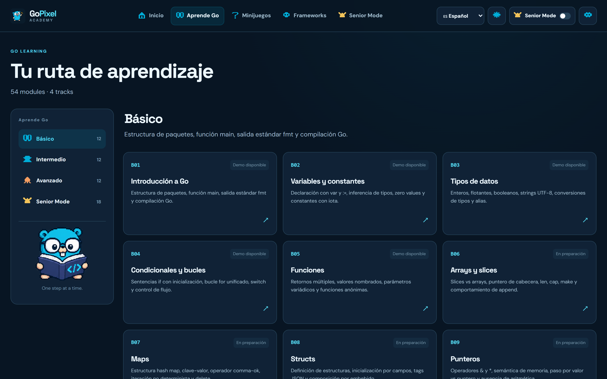
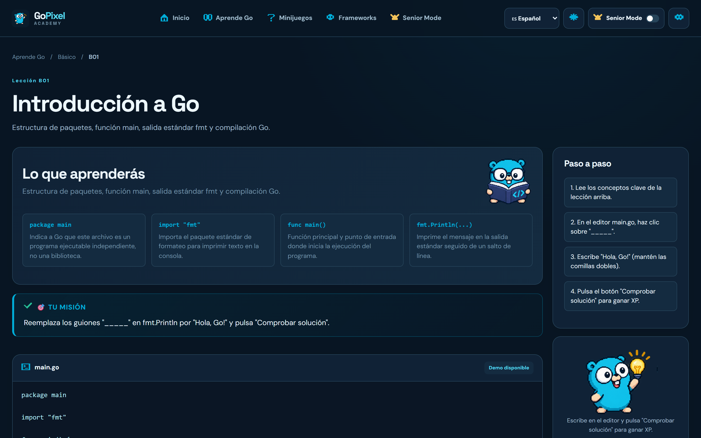
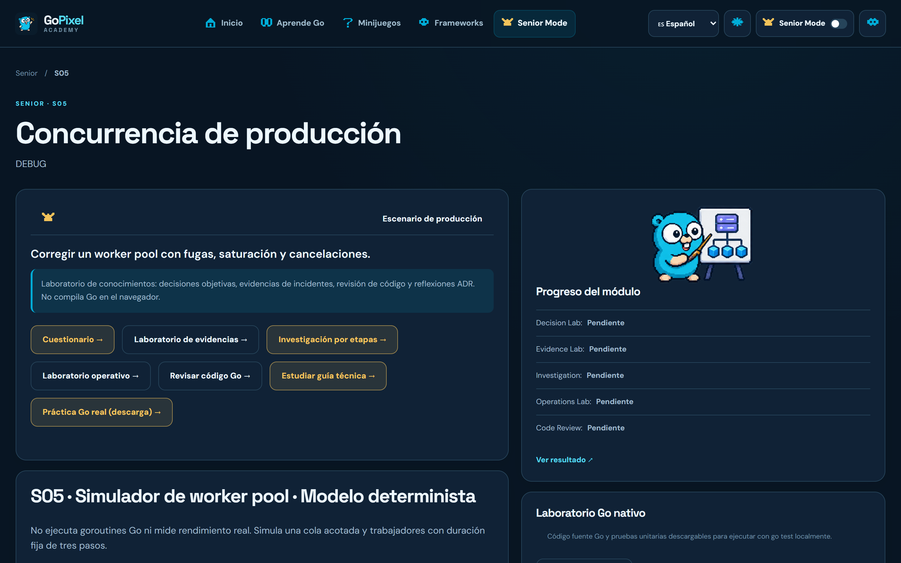
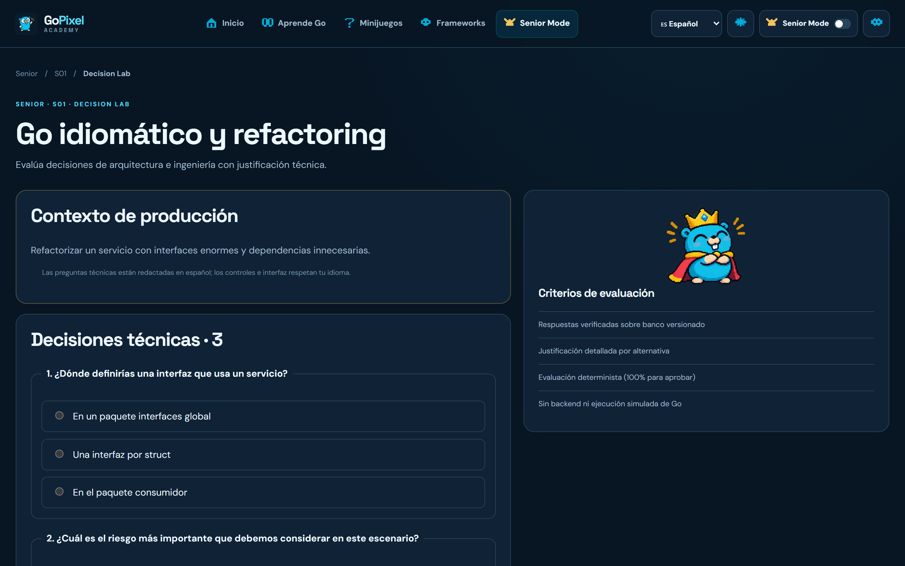
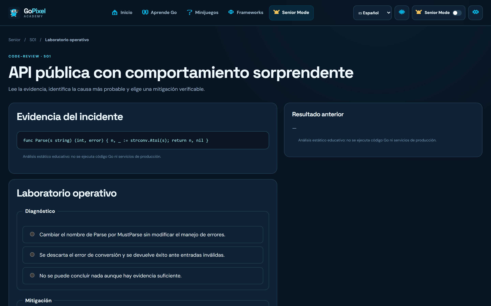
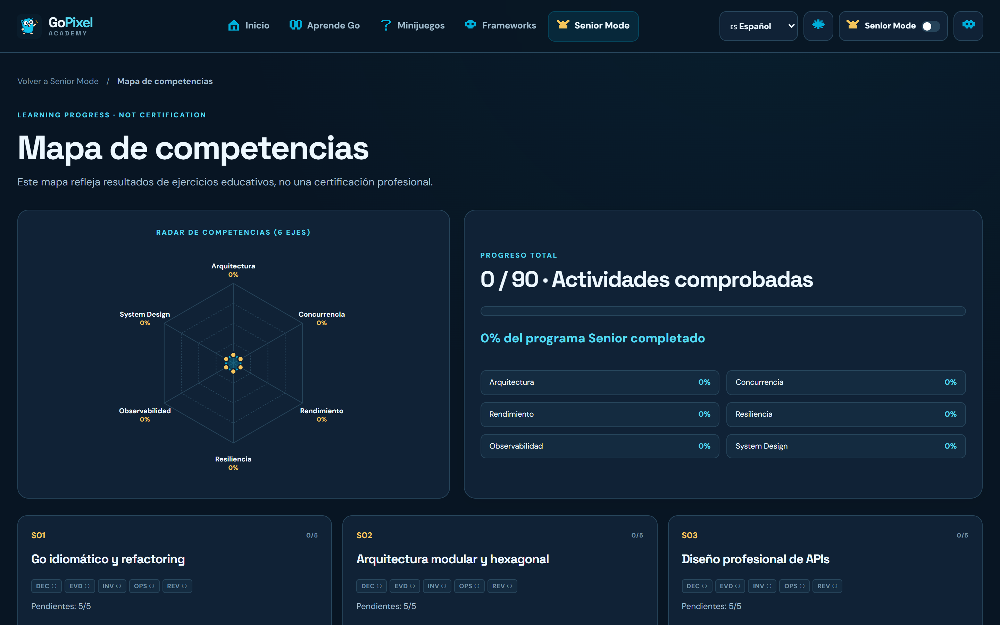
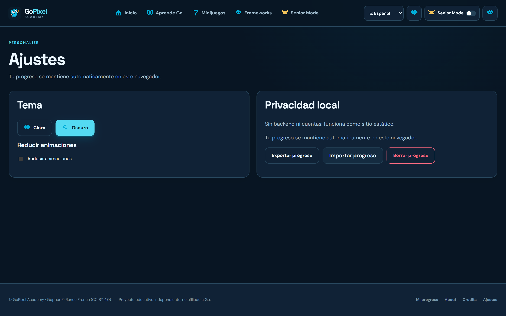
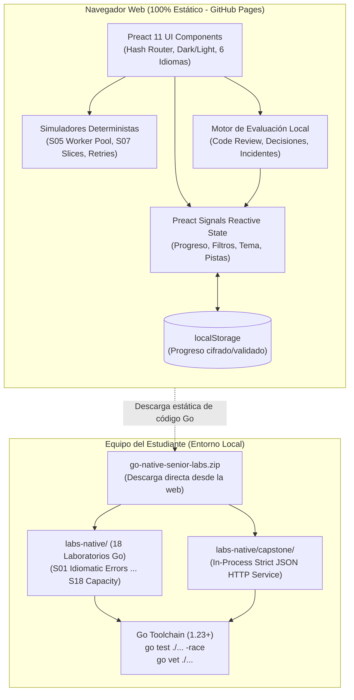

<div align="center">
  

  <h1>GoPixel Academy · Senior Mode v8</h1>

  <p>
    <a href="#see-how-it-works">Demos Interactivas</a> ·
    <a href="#dark--light-mode">Modo Oscuro & Claro</a> ·
    <a href="#whats-inside">Galería de Módulos</a> ·
    <a href="#quick-start-5-min">Inicio Rápido</a> ·
    <a href="#arquitectura-y-flujo-de-datos">Arquitectura</a> ·
    <a href="#testing-y-quality-gates">Quality Gates</a>
  </p>

  <p><b>Academia interactiva de Go y arquitectura de software de alta concurrencia para ingenieros Senior y Staff.</b></p>
  <p>Frontend SPA 100% estático en Preact 11 y Vite, estética pixel art moderna, simuladores matemáticos deterministas de concurrencia, 18 laboratorios nativos de Go con detección de data races (<code>go test -race</code>), banco de code review estático y capstone in-process con tolerancia a fallos.</p>

  <p>
    <a href="https://github.com/VigilioYonatan/gopixel-academy/actions/workflows/deploy.yml"></a>
    <a href="https://github.com/VigilioYonatan/gopixel-academy/actions/workflows/ci.yml"></a>
    
    
    
    
    
    
  </p>

  <p>
    <a href="https://vigilioyonatan.github.io/gopixel-academy/"></a>
    <a href="https://vigilioyonatan.github.io/gopixel-academy/downloads/go-native-senior-labs.zip"></a>
  </p>

  
  <p><sub>Panel principal de GoPixel Academy: navegación fluida por hash, métricas curriculares en vivo, selector de 6 idiomas y acceso directo al track de fundamentos y Senior Mode.</sub></p>
</div>

> [!NOTE]
> **Arquitectura 100% Estática y Soberanía Local (`v8.0.0`):** GoPixel Academy se despliega sin backend ni almacenamiento remoto en GitHub Pages. El progreso del estudiante se persiste de forma determinista y privada en `localStorage`. La ejecución del lenguaje Go nativo se realiza en el entorno local del estudiante (`labs-native/`) mediante la toolchain oficial de Go 1.23+, garantizando verificación estricta de concurrencia sin transmitir código ni credenciales.

---

## Tabla de Contenidos

1. [Los Retos de Producción que Resolvemos](#los-retos-de-producción-que-resolvemos)
2. [See How It Works (Demos Interactivas)](#see-how-it-works)
3. [Dark & Light Mode](#dark--light-mode)
4. [What's Inside (Galería de Módulos)](#whats-inside)
5. [Tech Stack](#tech-stack)
6. [Arquitectura y Flujo de Datos](#arquitectura-y-flujo-de-datos)
7. [Estructura del Repositorio](#estructura-del-repositorio)
8. [Inicio Rápido (< 5 min)](#quick-start-5-min)
9. [Variables de Entorno y Configuración](#variables-de-entorno-y-configuración)
10. [Testing y Quality Gates](#testing-y-quality-gates)
11. [CI/CD y Automatización](#cicd-y-automatización)
12. [Checklist del Desarrollador](#checklist-del-desarrollador)
13. [Troubleshooting y Preguntas Frecuentes](#troubleshooting-y-preguntas-frecuentes)
14. [Límites Explícitos y Transparencia](#límites-explícitos-y-transparencia)
15. [Licencia y Atribución](#licencia-y-atribución)

---

## Los Retos de Producción que Resolvemos

Aprender la sintaxis de Go es rápido, pero dominar la ingeniería de sistemas distribuidos y la concurrencia a nivel Senior requiere resolver escenarios reales de producción:

| Reto Operativo en Go | Riesgo en Producción | Cómo lo Resuelve GoPixel Academy |
| :--- | :--- | :--- |
| **1. Data Races & Goroutine Leaks** | Corrupción silenciosa de memoria, deadlocks y consumo descontrolado de RAM bajo carga. | **Laboratorios S05 y S06:** Simuladores deterministas de *Worker Pools* y *Atomics/Mutexes*, complementados con 18 suites Go nativas verificadas con `go test -race ./...`. |
| **2. Fuga de Memoria por Retención de Slices** | Retención oculta del backing array completo al recortar fragmentos pequeños de buffers grandes. | **Laboratorio S07:** Modelo matemático interactivo de retención de arrays subyacentes y guías de copia defensiva (`copy()`) con benchmarks comparativos. |
| **3. Reintentos No Idempotentes en APIs** | Doble facturación de transacciones y estados inconsistentes ante fallos de red en el cliente. | **Laboratorio S03 y Capstone Orders:** Patrón *Idempotency-Key* con persistencia de respuesta original, deduplicación de eventos y outbox transaccional in-process. |
| **4. Errores Opacos sin Causa Raíz** | `fmt.Errorf("%v")` indiscriminado destruye la cadena de tipos, impidiendo control programático en clientes. | **Laboratorio S01:** Errores de dominio idiomáticos con unwrapping seguro mediante `errors.Is` y `errors.As` estructurados. |
| **5. Apagado Abrupto de Servicios (*Shutdown*)** | Pérdida de peticiones en vuelo y corrupción de transacciones al recibir señales `SIGINT` o `SIGTERM`. | **Laboratorio S15:** Coordinación de cierre ordenado con drenado de canales, contextos acotados con timeout y `sync.WaitGroup`. |

---

## See How It Works

Grabaciones interactivas capturadas directamente de la plataforma **GoPixel Academy v8**:

### 1. Editor Interactivo de Go con Validación Inmediata
Edita código fuente de Go directamente en el navegador, consulta pistas idiomáticas y recibe retroalimentación inmediata sobre la solución:

<div align="center">
  
  <p><sub>🎬 Flujo interactivo: inspección de ejercicio, tipeo de solución en Go y comprobación con asignación de experiencia (+20 XP).</sub></p>
</div>

### 2. Simulador Determinista de Concurrencia y Worker Pool (S05)
Experimenta con variables de concurrencia (número de workers, capacidad del canal buffer, tasa de llegada de peticiones) y observa la saturación y rechazos sin inventar falsos hilos web:

<div align="center">
  
  <p><sub>🎬 Simulación matemática: ajuste dinámico de workers y capacidad de buffer con cálculo instantáneo de tasa de ocupación y ráfagas.</sub></p>
</div>

### 3. Banco de Code Review Senior & Cambio de Tema Instantáneo
Revisa diffs de Pull Requests en Go realista, toma decisiones arquitectónicas fundamentadas y conmuta entre Modo Oscuro y Modo Claro con contraste WCAG 2.2 AA:

<div align="center">
  
  <p><sub>🎬 Navegación Senior: análisis de diff de código, justificación de trade-offs y alternancia fluida de tema visual.</sub></p>
</div>

---

## Dark & Light Mode

GoPixel Academy incluye un sistema de diseño pixel art moderno de alto contraste con soporte completo para modo claro y oscuro, adaptable al instante desde el encabezado o los ajustes:

| Modo Oscuro (Dark Mode) | Modo Claro (Light Mode) |
| :---: | :---: |
|  |  |
| <sub>Paleta nocturna profunda (`#071521` y `#00ADD8`) optimizada para sesiones prolongadas de programación y análisis de código.</sub> | <sub>Paleta clara equilibrada con ratios de contraste conformes a WCAG 2.2 AA para entornos de alta luminosidad.</sub> |

---

## What's Inside

<table>
  <tr>
    <td width="50%">
      
      <p align="center"><sub><b>Catálogo Curricular Completo:</b> 54 módulos estructurados en 4 niveles (Básico, Intermedio, Avanzado, Senior) con trazabilidad por temas.</sub></p>
    </td>
    <td width="50%">
      
      <p align="center"><sub><b>Editor Interactivo Ligero:</b> Práctica de sintaxis fundamental de Go con validación determinista, pistas pedagógicas y persistencia local.</sub></p>
    </td>
  </tr>
  <tr>
    <td width="50%">
      
      <p align="center"><sub><b>Senior Mode Dashboard:</b> 18 desafíos de ingeniería avanzada con insignias de estado para Decisiones, Evidencias, Incidentes y Reviews.</sub></p>
    </td>
    <td width="50%">
      
      <p align="center"><sub><b>Simulador de Concurrencia (S05):</b> Modelo matemático de colas con rechazo por sobrecarga, monitoreo de cuellos de botella y utilización.</sub></p>
    </td>
  </tr>
  <tr>
    <td width="50%">
      
      <p align="center"><sub><b>Code Review Suite (36 Decisiones):</b> Pull Requests realistas en Go con evaluación de trade-offs, severidades y buenas prácticas de refactor.</sub></p>
    </td>
    <td width="50%">
      
      <p align="center"><sub><b>Architecture Decision Lab:</b> Casos de diseño de sistemas donde se penaliza la simplificación ingenua y se premia el criterio Senior.</sub></p>
    </td>
  </tr>
  <tr>
    <td width="50%">
      
      <p align="center"><sub><b>Evidence Analysis Lab:</b> Entrenamiento en diagnóstico con volcados de memoria, logs JSON de producción y trazas de profiling <code>pprof</code>.</sub></p>
    </td>
    <td width="50%">
      
      <p align="center"><sub><b>Operations & Incident Response:</b> Resolución de crisis de producción distinguiendo diagnóstico de causa raíz frente a mitigación de emergencia.</sub></p>
    </td>
  </tr>
  <tr>
    <td width="50%">
      
      <p align="center"><sub><b>Readiness Assessment Matrix:</b> Evaluación holística calculada sobre los 5 tipos de ejercicios locales, sin autoevaluaciones infladas.</sub></p>
    </td>
    <td width="50%">
      
      <p align="center"><sub><b>Production Capstone Service:</b> Microservicio in-process con Strict JSON HTTP, reserva concurrente de stock, idempotencia y fuzz testing.</sub></p>
    </td>
  </tr>
  <tr>
    <td width="50%">
      
      <p align="center"><sub><b>Frameworks Academy:</b> Comparativa técnica y ejemplos de arranque de 8 frameworks clave: net/http, Gin, Chi, Echo, Fiber, etc.</sub></p>
    </td>
    <td width="50%">
      
      <p align="center"><sub><b>Minijuegos Educativos:</b> Quiz Battle, completar código, ordenar sentencias y detección de bugs sin motores de juego pesados.</sub></p>
    </td>
  </tr>
  <tr>
    <td colspan="2">
      
      <p align="center"><sub><b>Ajustes, 6 Idiomas y Portabilidad:</b> Interfaz localizada en español, inglés, japonés, chino, portugués y francés, con exportación/importación JSON de progreso validada por esquema.</sub></p>
    </td>
  </tr>
</table>

---

## Tech Stack

Todas las versiones corresponden a la fuente única de verdad definida en [`package.json`](package.json) y [`labs-native/go.mod`](labs-native/go.mod):

- **Frontend Core:** [Preact](https://preactjs.com/) (`^10.27.0`) con [`@preact/signals`](https://preactjs.com/guide/v10/signals/) (`^2.2.1`) para reactividad de grano fino sin overhead.
- **Build Tool & Bundler:** [Vite](https://vite.dev/) (`^7.1.0`) con TypeScript (`^5.9.0`) estricto y `@preact/preset-vite`.
- **Motor Go Nativo:** [Go 1.23+](labs-native/go.mod) en `labs-native/` con `go test -race`, `go vet`, benchmarking y fuzzing nativos.
- **Linter & Formatter:** [Biome](https://biomejs.dev/) (`2.5.0`) con cero tolerancia a errores sintácticos y tipado estricto.
- **Testing Suite:** Node.js native test runner (`node --test`), pruebas de integridad de assets (`scripts/audit-assets.mjs`), auditoría estática de imports y bundle nativo (`audit-native-bundle.py`).
- **Showcase & E2E Testing:** [Puppeteer-core](https://pptr.dev/) (`^25.17.0`) para pruebas de navegación por hash, verificación de botones y capturas Retina 2x automatizadas.
- **Despliegue & CI/CD:** GitHub Actions (`deploy.yml`, `ci.yml`) con compilación estática y hosting en [GitHub Pages](https://pages.github.com/).

---

## Arquitectura y Flujo de Datos

GoPixel Academy implementa una arquitectura limpia y desacoplada que separa de manera estricta el frontend web de la ejecución de código en la máquina del estudiante:



### Principios de Arquitectura Vigentes:
- **Cero Backend:** La SPA no consume APIs remotas privadas ni almacena datos de telemetría.
- **Evaluación No Compilada en Web:** El motor del navegador valida patrones de código mediante expresiones regulares seguras y reglas pedagógicas; **no** ejecuta código Go arbitrario en el cliente.
- **Verificación Real en Local:** Toda afirmación de concurrencia y ausencia de *data races* se audita ejecutando `go test -race` directamente en la terminal local del estudiante.

---

## Estructura del Repositorio

```
gopixel-academy/
├── .github/
│   └── workflows/
│       ├── ci.yml                 # Quality & Security: content check, imports, go race tests, audit
│       └── deploy.yml             # Despliegue continuo a GitHub Pages mediante actions/deploy-pages
├── docs/                          # Documentación canónica de arquitectura y especificaciones
│   ├── architecture/              # Guías de arquitectura, rutas, límites del runtime y Vigilio
│   ├── assets/                    # Assets del README (capturas Retina 2x, demos y logo)
│   ├── content/                   # Manifiestos curriculares y especificación de los 18 labs
│   ├── devsecops/                 # Threat model, políticas de release gates y privacidad
│   └── senior/                    # Documentación profunda de guías, competencias y capstone
├── labs-native/                   # 18 Laboratorios Go nativos + Capstone listos para compilar
│   ├── capstone/                  # Servicio de pedidos in-process con Strict JSON y concurrencia
│   ├── s01-idiomatic-errors/ ...  # Laboratorios S01 al S18 con tests unitarios y -race
│   └── go.mod                     # Módulo Go fijado en go 1.23
├── public/                        # Assets estáticos distribuidos con la aplicación
│   ├── assets/                    # Sprites pixel art del Gopher, iconos, temas y fondos
│   └── downloads/                 # Paquete empaquetado go-native-senior-labs.zip
├── scripts/                       # Scripts de automatización, verificación y generación de media
│   ├── audit-assets.mjs           # Auditoría de integridad de sprites y JSONs
│   ├── audit-native-bundle.py     # Verificación byte-a-byte del ZIP de laboratorios nativos
│   ├── audit-static-imports.py    # Control de importaciones relativas estrictas
│   ├── generate_showcase_media.cjs# Generador de capturas Retina 2x y grabaciones de demostración
│   └── test-all-buttons-e2e.js    # Suite E2E de verificación de 54 botones y navegación
├── src/                           # Código fuente TypeScript + Preact de la aplicación
│   ├── app/                       # Routing principal por hash, layouts y navegación global
│   ├── content/senior/            # Bancos de preguntas, investigaciones, incidentes y reviews
│   ├── data/                      # Manifiesto curricular de los 54 módulos de Go
│   ├── features/                  # Módulos por responsabilidad (learning, senior, games, settings)
│   ├── i18n/                      # Diccionarios de traducción en 6 idiomas (es, en, ja, zh, pt, fr)
│   └── styles/                    # Sistema de diseño pixel art, variables CSS y temas Dark/Light
└── tests/                         # Pruebas automatizadas de estructura, integridad y contenido
```

---

## Quick Start (< 5 min)

### Prerrequisitos
- **Node.js**: `v20` o `v22` (con `npm`)
- **Go**: `1.23+` (para ejecutar los laboratorios nativos concurrentes)
- **Navegador Moderno**: Chrome, Brave, Edge o Firefox

### 1. Clonar el repositorio
```bash
git clone https://github.com/VigilioYonatan/gopixel-academy.git
cd gopixel-academy
```

### 2. Instalar dependencias del frontend
```bash
npm install
```

### 3. Iniciar el entorno de desarrollo
```bash
npm run dev
```
Abre en tu navegador: `http://localhost:5173/gopixel-academy/` (o el puerto indicado en la consola).

### 4. Compilar para producción (Build estático)
```bash
npm run build
```
Los artefactos compilados y optimizados se generarán en la carpeta `dist/`.

---

## Variables de Entorno y Configuración

Dado que el frontend es una SPA 100% estática que corre en el navegador del usuario, **no requiere credenciales ni secretos**:

| Variable | Tipo | Default | Descripción |
| :--- | :---: | :---: | :--- |
| `VITE_BASE` | String | `/gopixel-academy/` | Ruta base de la aplicación. Configurable para forks o dominios raíz (`VITE_BASE=/`). |

---

## Testing y Quality Gates

GoPixel Academy cuenta con una batería integral de pruebas en dos niveles: calidad frontend y verificación de concurrencia Go nativa:

```bash
# 1. Pruebas de contenido y estructura curricular (56/56 PASS)
npm run check:content

# 2. Verificación de linter y tipado estricto
npm run lint
npm run typecheck

# 3. Suite E2E de interfaz (validación de formularios, navegación y 54 botones)
npm run test:buttons

# 4. Pruebas Go Nativas con Detección de Data Races (-race)
cd labs-native
go test ./... -count=1
go test -race ./... -count=1
go vet ./...
```

---

## CI/CD y Automatización

El repositorio cuenta con dos workflows de **GitHub Actions** automatizados:

1. **`Quality & Security` (`ci.yml`):**
   - Ejecuta `npm ci` y verificación de contenido (`check:content`).
   - Audita importaciones relativas estrictas (`audit-static-imports.py`).
   - Verifica vulnerabilidades de dependencias con `npm audit --audit-level=high`.
   - Compila la suite nativa de Go con `-race` y valida el ZIP descargable (`audit-native-bundle.py`).
2. **`Deploy GoPixel Academy` (`deploy.yml`):**
   - Compila la aplicación Preact en modo producción.
   - Sube el artefacto a la infraestructura de GitHub Pages mediante `actions/deploy-pages@v4`.
   - Publica la versión viva en: **[https://vigilioyonatan.github.io/gopixel-academy/](https://vigilioyonatan.github.io/gopixel-academy/)**.

---

## Checklist del Desarrollador

Antes de emitir un Pull Request o publicar una nueva versión, verifica que se cumpla la política de entrega sin atajos (*Complete Work*):

- [x] `npm run check:content` pasa sin errores (56/56 tests OK).
- [x] `npm run lint` no reporta violaciones de formato ni errores de Biome.
- [x] `npm run build` genera la carpeta `dist/` sin advertencias de tipado.
- [x] `cd labs-native && go test -race ./...` finaliza con cero fallos de concurrencia.
- [x] Si se modifica código en `labs-native/`, se regenera `public/downloads/go-native-senior-labs.zip` y pasa `python3 scripts/audit-native-bundle.py`.
- [x] Nuevas pantallas incorporan soporte para Modo Oscuro, Modo Claro y etiquetas en los 6 idiomas.
- [x] No se introducen dependencias de red, librerías de analítica externa ni secretos en el código.

---

## Troubleshooting y Preguntas Frecuentes

### 1. `go test -race` falla indicando que gcc no está instalado en Windows
- **Causa:** El detector de carreras de Go (`-race`) utiliza CGO en Windows y requiere un compilador C en el `PATH` (como MinGW-w64 o TDM-GCC).
- **Solución:** Instala MinGW vía Chocolatey/Scoop (`choco install mingw` o `scoop install gcc`) o ejecuta los tests en WSL2 / Linux donde `gcc` ya está presente.

### 2. Al abrir la web en local veo una pantalla en blanco con error 404 de assets
- **Causa:** Vite está configurado por defecto con el prefijo `/gopixel-academy/`.
- **Solución:** Accede a la URL completa con el prefijo: `http://localhost:5173/gopixel-academy/`. Si deseas correrlo en la raíz, ejecuta `VITE_BASE=/ npm run dev`.

### 3. ¿El editor de código ejecuta Go en el servidor?
- **Respuesta:** No. GoPixel Academy es 100% estático. La verificación en el navegador utiliza reglas pedagógicas locales. Para compilar y ejecutar código Go real con el compilador oficial, descarga los laboratorios nativos con el botón de descarga y ejecútalos con tu instalación local de Go.

---

## Límites Explícitos y Transparencia

En cumplimiento de las políticas de **Vigilio Auto-Senior** y **Zero Omissions**:

1. **Sin Compilador Go en el Navegador:** No se incluye runtime WebAssembly de Go pesado ni compilación remota; los ejercicios web son interactivos y pedagógicos.
2. **Alcance Curricular:** De los 54 módulos catalogados, los módulos fundamentales cuentan con ejercicios interactivos y los 18 módulos Senior disponen de laboratorios completos. Los módulos intermedios restantes se encuentran como especificaciones curriculares planificadas.
3. **Localización:** Toda la navegación, botones, títulos, temas y paneles de configuración están traducidos a los 6 idiomas (es, en, ja, zh, pt, fr). El código fuente de los laboratorios nativos de Go y los textos técnicos especializados se presentan principalmente en español e inglés.

---

## Licencia y Atribución

- **Código y Contenido:** Publicado bajo la licencia [MIT License](LICENSE).
- **Mascota Oficial de Go:** El diseño original del **Go Gopher** fue creado por [Renee French](https://reneefrench.blogspot.com/) y está licenciado bajo [Creative Commons Attribution 4.0 International (CC BY 4.0)](https://creativecommons.org/licenses/by/4.0/). Las adaptaciones en estilo pixel art y variaciones presentes en GoPixel Academy conservan su respectiva atribución de autoría.
