<div align="center">
  

  <h1>GoPixel Academy</h1>

  <p><b>Aprende Go desde cero hasta nivel Senior con desafíos interactivos, simuladores y práctica real de producción.</b></p>

  <p>
    <a href="#qué-hay-en-este-repositorio">Qué hay en este repo</a> ·
    <a href="#qué-resuelve-senior-mode">Qué resuelve Senior Mode</a> ·
    <a href="#videos-y-demos-en-acción">Videos & Demos</a> ·
    <a href="#cómo-empezar-en-2-minutos">Cómo Empezar</a> ·
    <a href="https://vigilioyonatan.github.io/gopixel-academy/">Probar Web en Vivo</a>
  </p>

  <p>
    <a href="https://github.com/VigilioYonatan/gopixel-academy/actions"></a>
    
    
    
    
    
  </p>

  <p>
    <a href="https://vigilioyonatan.github.io/gopixel-academy/"></a>
    <a href="https://vigilioyonatan.github.io/gopixel-academy/downloads/go-native-senior-labs.zip"></a>
  </p>

  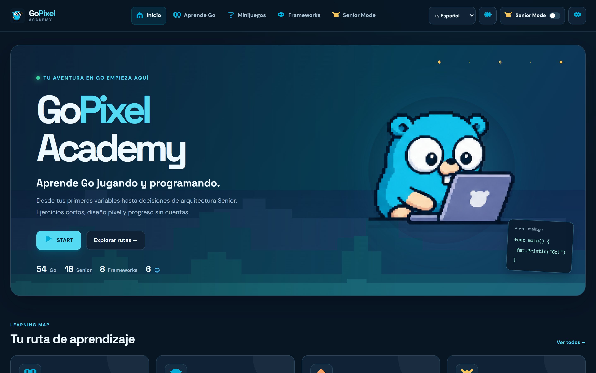
</div>

> [!NOTE]
> **100% Gratuito y sin registros:** Esta aplicación funciona directamente en tu navegador sin crear cuentas, sin servidores ocultos y sin guardar tus datos en la nube. Tu progreso se guarda automáticamente en tu propio equipo.

---

## ¿Qué hay en este repositorio?

GoPixel Academy es una plataforma educativa interactiva con arte pixel moderno pensada para que aprender Go sea entretenido, visual y práctico:

* 🎓 **54 Módulos de Aprendizaje:** Desde lo más básico (variables, funciones, slices, punteros) hasta concurrencia avanzada y diseño de software.
* 👑 **Senior Mode (18 Desafíos Prácticos):** Casos reales donde aprendes a tomar decisiones de arquitectura, diagnosticar fallos de memoria y resolver incidentes como un ingeniero senior.
* 💻 **Editor Interactivo en la Web:** Practica código Go directamente en tu navegador con pistas idiomáticas y corrección al instante sin instalar nada.
* 🧪 **18 Laboratorios Go Nativos Descargables:** Si quieres compilar en tu computadora, descargas la carpeta con código Go real y pruebas automatizadas (`go test -race`).
* 🎮 **Minijuegos Educativos:** Batallas de preguntas (Quiz), completar código, ordenar bloques de lógica y cacería de bugs.
* 🌐 **6 Idiomas y Dos Temas:** Puedes usar toda la plataforma en español, inglés, japonés, chino, portugués o francés, y alternar entre Modo Oscuro y Modo Claro.

---

## ¿Qué resuelve Senior Mode?

Casi todos los cursos y tutoriales de Go en internet te enseñan la sintaxis básica: qué es un `for`, un `struct` o una `goroutine`. Pero cuando entras a trabajar en una empresa o construyes un sistema en producción, **ahí es donde empiezan los dolores de cabeza reales**.

GoPixel Academy nació para cerrar esa brecha y resolver estos 5 problemas comunes:

```
                  ┌────────────────────────────────────────┐
                  │        LOS PROBLEMAS DE PRODUCCIÓN     │
                  └───────────────────┬────────────────────┘
                                      │
         ┌────────────────────────────┼────────────────────────────┐
         ▼                            ▼                            ▼
  🚨 Concurrencia a ciegas     💾 Fugas de Memoria en Slices  ⚡ Caídas por Saturación
 (Data races que rompen datos) (Gasto gigante de RAM oculto)  (Miles de peticiones de golpe)
         │                            │                            │
         ▼                            ▼                            ▼
  ✅ Laboratorios S05 y S06    ✅ Laboratorio S07 y Guías   ✅ Simulador de Worker Pools
 (Detectores de carrera Go)   (Técnicas de copia segura)    (Colas y control de ráfagas)
```

1. **¿Por qué mi programa falla a veces sí y a veces no? (*Data Races*)**
   * *El problema:* Lanzar goroutines sin control causa que dos funciones escriban en la misma memoria a la vez, corrompiendo datos en silencio.
   * *Cómo te ayuda Senior Mode:* Te enseña a usar canales, exclusión mutua (`sync.Mutex`) y atómicos, y te da pruebas nativas con `go test -race` para detectar errores antes de que lleguen a los usuarios.

2. **¿Por qué mi servidor consume gigabytes de RAM si solo leí un texto pequeño? (*Retención de Slices*)**
   * *El problema:* En Go, si cortas un pedacito de un archivo gigante, Go mantiene todo el archivo original en memoria sin que te des cuenta.
   * *Cómo te ayuda Senior Mode:* El simulador interactivo S07 te muestra visualmente cómo ocurre esta fuga y cómo solucionarla con copias defensivas.

3. **¿Qué pasa si el internet falla y el cliente vuelve a pagar? (*Idempotencia*)**
   * *El problema:* Una red inestable reintenta peticiones de cobro, provocando cobros duplicados a los clientes.
   * *Cómo te ayuda Senior Mode:* Aprendes a implementar claves de idempotencia y deduplicación de eventos para que una orden nunca se cobre dos veces.

4. **¿Cómo evito que mi servidor muera cuando llegan miles de peticiones juntas? (*Worker Pools*)**
   * *El problema:* Crear millones de goroutines sin límite satura la CPU y tira el sistema abajo.
   * *Cómo te ayuda Senior Mode:* Juegas con el simulador de Worker Pool (S05) para entender cómo dimensionar trabajadores y colas según el tráfico.

5. **Aprender a revisar código de otros (*Code Review*)**
   * *Cómo te ayuda Senior Mode:* Te pone frente a pull requests reales de Go para que detectes malas prácticas, propongas soluciones y justifiques tus decisiones.

---

## Videos y Demos en Acción

Aquí puedes ver la plataforma funcionando en grabaciones reales:

### 1. Editor Interactivo de Go (Práctica directa en la web)
Escribe tu código, pide pistas si te quedas trabado y valida tu solución en un solo clic:

<div align="center">
  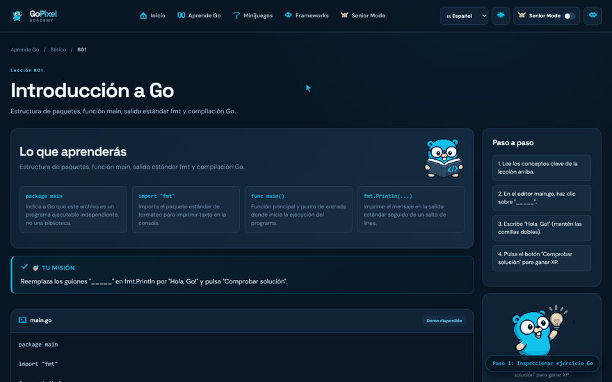
  <p>
    🎬 <b>Video en Alta Definición:</b>
    <a href="docs/assets/videos/01-interactive-go-editor.webm"><b>Abrir video WebM (01-interactive-go-editor.webm)</b></a>
  </p>
</div>

---

### 2. Simulador de Concurrencia y Worker Pool (S05)
Ajusta la cantidad de trabajadores y el tamaño de la cola para ver en tiempo real cómo responde el sistema ante ráfagas de usuarios:

<div align="center">
  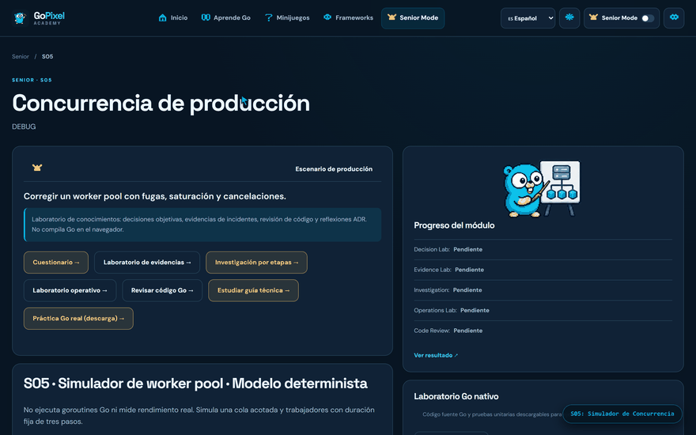
  <p>
    🎬 <b>Video en Alta Definición:</b>
    <a href="docs/assets/videos/02-senior-worker-pool-simulation.webm"><b>Abrir video WebM (02-senior-worker-pool-simulation.webm)</b></a>
  </p>
</div>

---

### 3. Recorrido por Senior Mode, Code Review y Cambio de Tema
Explora los retos de arquitectura, revisa código de Pull Requests y cambia entre Modo Oscuro y Modo Claro:

<div align="center">
  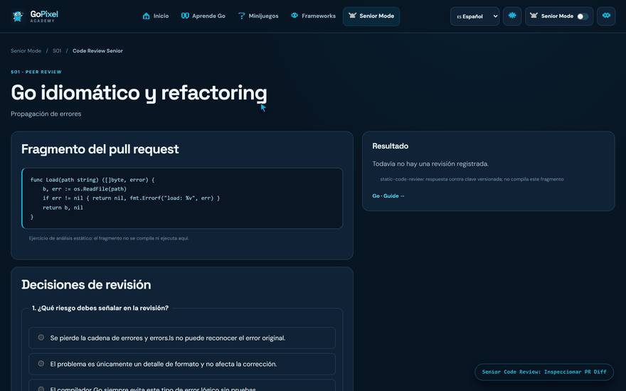
  <p>
    🎬 <b>Video Completo de Recorrido:</b>
    <a href="docs/assets/videos/03-senior-mode-walkthrough.webm"><b>Abrir video WebM (03-senior-mode-walkthrough.webm)</b></a>
  </p>
</div>

---

## Modo Oscuro y Modo Claro

Diseñado pensando en tu comodidad visual: una estética retro-moderna con contraste accesible para el día o la noche:

| Modo Oscuro | Modo Claro |
| :---: | :---: |
|  | 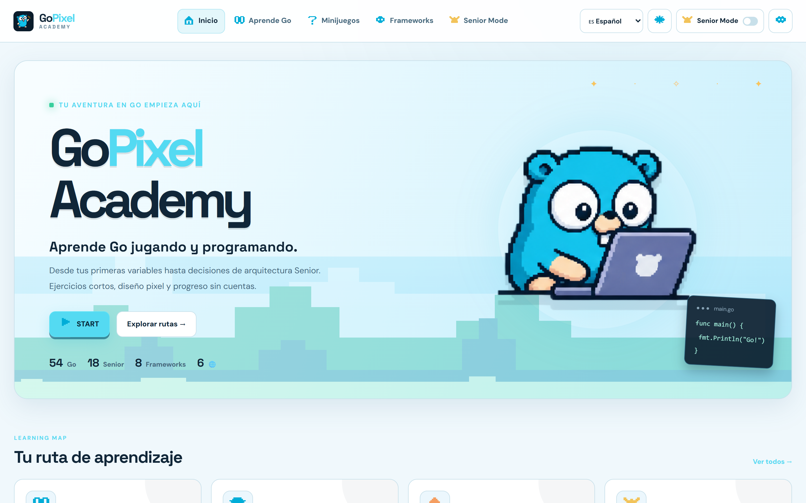 |
| <sub>Para programar de noche con menos cansancio visual.</sub> | <sub>Limpio y claro para estudiar de día en la oficina.</sub> |

---

## Galería de Módulos

<table>
  <tr>
    <td width="50%">
      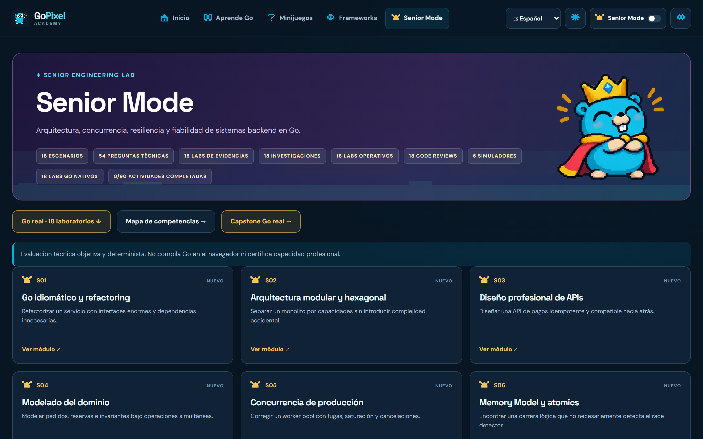
      <p align="center"><sub><b>Panel Senior Mode:</b> 18 desafíos con seguimiento de decisiones, evidencias y revisiones de código.</sub></p>
    </td>
    <td width="50%">
      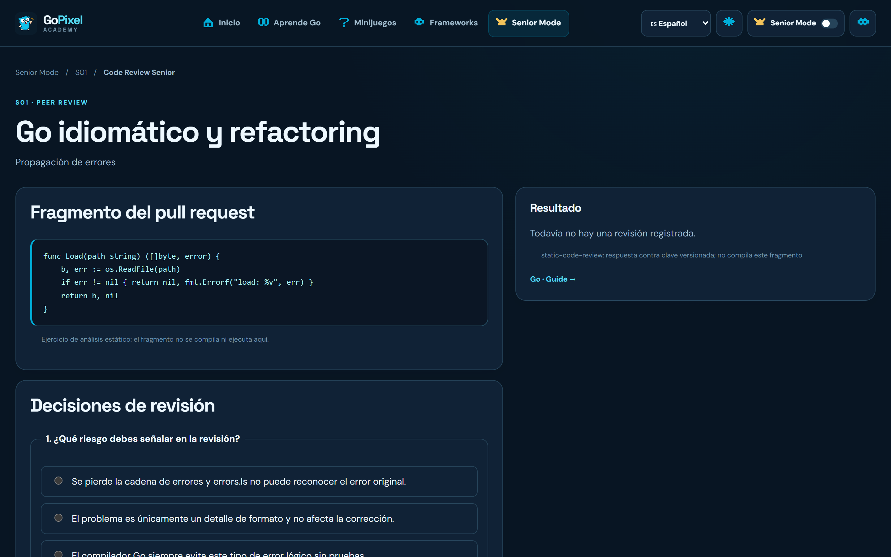
      <p align="center"><sub><b>Code Review:</b> Analiza diffs reales de código Go y detecta riesgos antes de fusionar un cambio.</sub></p>
    </td>
  </tr>
  <tr>
    <td width="50%">
      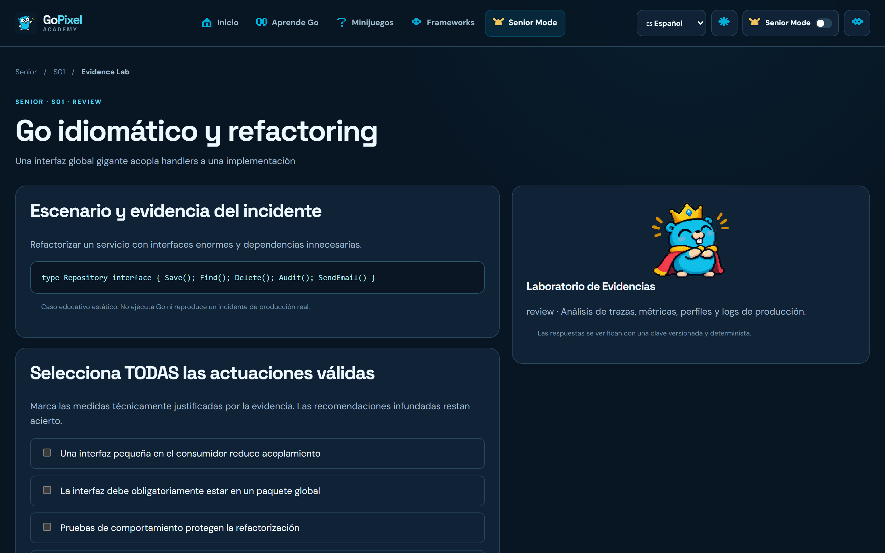
      <p align="center"><sub><b>Laboratorio de Evidencias:</b> Aprende a interpretar logs de producción y reportes de memoria (pprof).</sub></p>
    </td>
    <td width="50%">
      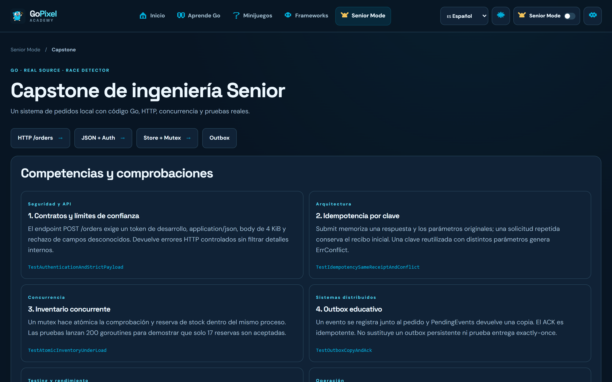
      <p align="center"><sub><b>Proyecto Capstone:</b> Un microservicio completo en Go con control estricto de concurrencia e inventario.</sub></p>
    </td>
  </tr>
  <tr>
    <td width="50%">
      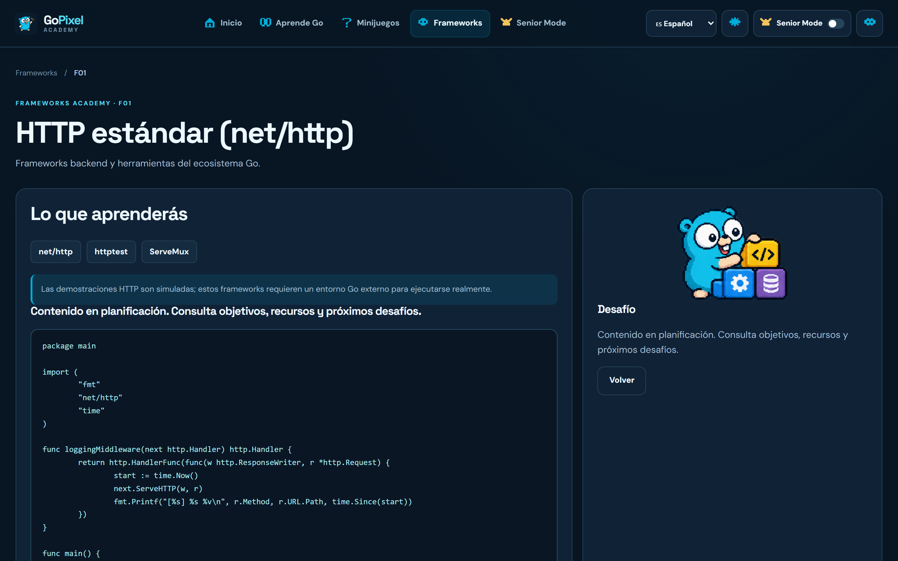
      <p align="center"><sub><b>Frameworks de Go:</b> Conoce y compara herramientas populares como Gin, Chi, Fiber y net/http.</sub></p>
    </td>
    <td width="50%">
      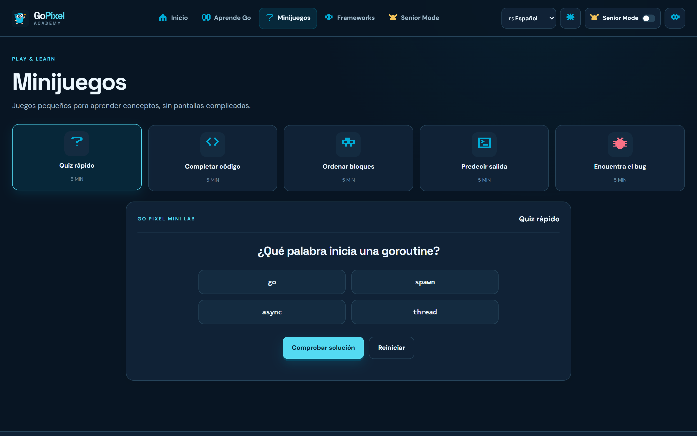
      <p align="center"><sub><b>Minijuegos:</b> Pon a prueba tus reflejos mentales con preguntas rápidas y ejercicios de lógica.</sub></p>
    </td>
  </tr>
</table>

---

## Cómo Empezar en 2 minutos

No necesitas bases de datos complejas ni configuraciones raras.

### Opción A: Usar la web directamente (Sin instalar nada)
Solo entra a: 👉 **[https://vigilioyonatan.github.io/gopixel-academy/](https://vigilioyonatan.github.io/gopixel-academy/)**

---

### Opción B: Ejecutar el proyecto en tu máquina
Si quieres correr el código en tu computadora:

```bash
# 1. Clona el repositorio
git clone https://github.com/VigilioYonatan/gopixel-academy.git
cd gopixel-academy

# 2. Instala las dependencias
npm install

# 3. Inicia la aplicación
npm run dev
```

Abre tu navegador en: `http://localhost:5173/gopixel-academy/` ¡y listo!

---

### Opción C: Ejecutar los ejercicios nativos de Go
Si tienes Go instalado en tu máquina y quieres probar los 18 retos con el detector de carreras de Go:

```bash
cd labs-native
go test ./... -count=1
go test -race ./... -count=1
```

---

## Tecnologías que usa este proyecto

Pocas dependencias, código limpio y máximo rendimiento:

* **Frontend:** Preact + Vite + TypeScript (muy rápido y pesa poquísimo).
* **Estilos:** CSS puro con variables y arte pixel moderno (sin frameworks pesados).
* **Código Go:** Go 1.23+ estándar (sin librerías raras, usando la biblioteca estándar de Go).
* **Alojamiento:** GitHub Pages con despliegue automático mediante GitHub Actions.

---

## Licencia y Créditos

* **Código:** Licencia [MIT](LICENSE) libre para aprender, modificar y compartir.
* **Mascota Gopher:** El Go Gopher original fue diseñado por [Renee French](https://reneefrench.blogspot.com/) bajo licencia [Creative Commons Attribution 4.0](https://creativecommons.org/licenses/by/4.0/). Las adaptaciones pixel art de esta academia conservan su atribución.
